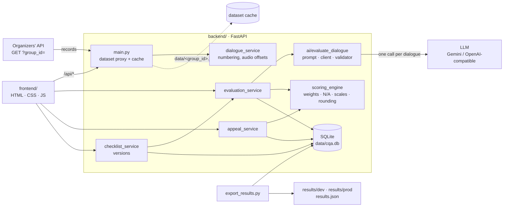

# Architecture

One FastAPI backend serves both the API and the frontend. The LLM is used for one thing only: reading a
conversation and answering each checklist criterion with evidence. Everything numeric is deterministic code.



## Components

| Part | File | Responsibility |
|---|---|---|
| API | `backend/main.py` | Routes, CORS, error format `{detail, problems}`, dataset proxy, serves `frontend/` at `/` |
| Dataset | `main.py`, `dialogue_service.py` | Loads a `group_id` from the organizers' API, keeps one cache file per group (`data/DEV.json`, control set separately), serves the cache after a restart or when the API is down. Adds `index` and `offset_sec` to each message; original timestamps are untouched |
| AI | `backend/ai/` | `evaluate_dialogue(dialogue, checklist)`: builds the prompt from the checklist it receives, calls the model, validates the JSON (allowed values, N/A only where allowed, quotes really exist), retries with the problem list. Returns answers and evidence, never a total |
| Evaluation | `evaluation_service.py` | Takes the active checklist, calls the AI, maps the answer to the checklist, rejects anything the scoring engine would not accept, stores it. A dialogue already evaluated under the same checklist version is returned from the database without an AI call |
| Scoring | `scoring_engine.py` | Pure math, see below. Also scores reviewer overrides on top of the AI answers |
| Appeals | `appeal_service.py` | Appeal on one criterion with a comment; reviewer confirms or changes it with a required reason. Never edits the stored AI answer |
| Checklist | `checklist_service.py` | Saves every change as a new version and makes it active. Old evaluations keep their version |
| Storage | `db.py` | SQLite tables below. One short connection per operation, WAL mode |
| Export | `export_results.py` | Writes `results/<set>/results.json` in the organizers' format and checks it |
| UI | `frontend/` | Registry with filters, transcript with audio, score panel with evidence links, appeal and reviewer dialogs, checklist editor |

## Main flows

**Load a dataset.** `GET /api/dialogues?group_id=X` → in memory? → cache file `data/X.json`? → organizer API
(`group_id` swapped into the signed link, `isSuccess` checked) → cache written. The control set never overwrites DEV.

**Evaluate.** `POST /api/evaluate/{id}?group_id=X` → saved result for (group, dialogue, active checklist version)?
return it → else `ai.evaluate_dialogue()` → answers mapped to checklist ids → `scoring_engine.score()` must accept
them → stored → evaluation card returned. Invalid AI output is never stored: the API answers 502 with the list
of problems.

**Appeal.** `POST /api/appeal {evaluation_id, criterion_id, comment}` → reviewer queue `GET /api/appeals` (comment,
disputed criterion, transcript fragment) → `POST /api/appeal/{id}/decision {decision: confirm|change, reason,
answer}` → the change becomes an override → total recalculated from the stored answers plus overrides.

**Change the checklist.** `PUT /api/checklist` → new active version → the UI re-evaluates the loaded dataset
(each dialogue once, because the new version has no saved results yet).

**Export.** `python export_results.py --set dev|prod` → latest evaluation per dialogue → organizer JSON 1.0 → format check.

## Scoring rules (from the checklist PDF)

1. N/A only where the criterion allows it and its condition holds.
2. "Yes" = full weight, "No" = 0. A scale step gives `step ÷ top step × weight`; the top step gives the full weight.
3. N/A criteria are dropped and their weight is spread proportionally over the applicable ones, so the maximum stays 100.
4. The total is rounded to two decimals, half-up (exact fractions, not floats). No applicable weighted criterion → no total.
5. Gross errors carry no points: they set `critical_error` and never change the total.

Example: contact Yes (10), needs N/A, identification N/A, consultation 15 of 20 (weight 20), empathy Yes (15),
dialogue 7 of 10 (weight 15), closing No (5). Applicable weight 65, earned 10 + 15 + 15 + 10.5 + 0 = 50.5,
total 50.5 ÷ 65 × 100 = **77.69**. A reviewer changes closing to Yes: 55.5 ÷ 65 × 100 = **85.38**.

## AI contract

What `evaluate_dialogue()` returns (`schemas.AIResult`):

```json
{
  "criteria": [
    {"criterion_id": "contact", "status": "PASS", "score": null,
     "evidence": {"message_index": 9, "speaker": "operator", "timestamp": "01:15", "quote": "Здравствуйте! Меня зовут Алина."},
     "reason": "Поздоровался и представился.", "checked_range": null}
  ],
  "critical_error": false,
  "critical_error_evidence": [],
  "summary": "...",
  "detected_language": "RU"
}
```

- `criterion_id` is exactly the id from the checklist it received, so a replaced criterion needs no code change.
- `status` is `PASS`, `FAIL` or `NA`; `score` is a scale step and is used only for scale criteria.
- The gross-error criterion is answered through `critical_error` and `critical_error_evidence`.

## Storage

| Table | Holds |
|---|---|
| `checklists` | version, name, full configuration JSON, note, active flag |
| `evaluations` | group, dialogue, checklist version, language, channel, AI answers, raw AI output with model and summary. Re-running inserts a new row, so history is kept. Totals are not stored: they are recalculated on read, so they can never go stale |
| `appeals` | evaluation, criterion, comment, author, status (`open` / `confirmed` / `changed`), original answer, decision answer, reason, reviewer, times |

## API

| Method | Path | Purpose |
|---|---|---|
| GET | `/health` | server check |
| GET | `/api/dataset/{group_id}?refresh=` | load a dataset, counts by language and channel |
| GET | `/api/dialogues?group_id&language&channel&status&q` | registry; each row has `title` and `evaluation` (total, critical error, open appeals) or null |
| GET | `/api/dialogues/{id}?group_id` | full dialogue with `index` and `offset_sec` per message |
| POST | `/api/evaluate/{id}?group_id&force_refresh&checklist_version` | evaluate one dialogue |
| POST | `/api/evaluate/batch` | evaluate many with limited parallelism |
| GET | `/api/evaluation/{id}?group_id&checklist_version` | latest evaluation card |
| POST | `/api/appeal` | create an appeal |
| GET | `/api/appeals?status&group_id` | reviewer queue (`status=all` for every appeal) |
| POST | `/api/appeal/{id}/decision` | reviewer decision, returns the recalculated card |
| GET / PUT | `/api/checklist` | active checklist / save a new version |
| GET | `/api/checklist/versions` | version list |
| POST | `/api/score` | stateless scoring for given answers |
| GET | `/api/usage` | LLM token counters for the cost estimate |

Full request and response examples: `backend/API.md` and `/docs`.

## Failure handling

| Situation | What happens |
|---|---|
| Organizer API down or slow | Saved copy in `data/<group_id>.json` is used |
| LLM quota or timeout | That dialogue fails with the reason; nothing is stored; the batch continues; running it again only retries the failed ones |
| AI answer does not match the checklist | 502 with the list of problems; nothing is stored |
| A dialogue cannot be evaluated at export time | Written as `"status": "error"` with the reason, never as a zero score |

## Frontend

Plain HTML, CSS and JavaScript with no build step and no external dependencies. The API base is relative (`/api`)
when served by the backend, and `http://localhost:8000/api` when opened from disk. All paths live in one place
(`EP` in `app.js`). This keeps the page ready to move into a Dynamics 365 HTML web resource.

## Security

Secrets (`ORGANIZER_API_URL` with its `sig=`, the LLM key) live only in `backend/.env`, which is in `.gitignore`.
There is no sign-in, as allowed by the task.
